<div align="center">


<br>


</div>

# MAEC Performance Report

A six-page static website that presents the digital marketing results for **[maec.ai](https://maec.ai)** between **1 July and 31 October 2026**: quality backlinks, brand building and a cleaner, faster path to demo bookings. It was prepared by **Mohamed Ismail** (Digital Marketing) for **MAEC by IntoAEC**.

There is no build step and no package to install. Open `index.html` and the report is ready.

---

## Highlights

<p align="center">
  
</p>

| Metric | Result |
| --- | --- |
| Domain authority | **5 → 14** (+9 points) |
| Active users | **3k** (+238.7%) |
| Sessions | **3.8k** (+148.5%) |
| Demo booking page speed | **4 → 90+** on PageSpeed (clone page) |

---

## What the report covers

| # | Page | What it shows |
| --- | --- | --- |
| 01 | [`index.html`](index.html) | Introduction, profile card and headline numbers |
| 02 | [`achievements.html`](achievements.html) | The eight activities delivered over the four months |
| 03 | [`website.html`](website.html) | GA4 growth, top pages and traffic sources for maec.ai |
| 04 | [`seo.html`](seo.html) | Domain authority, backlink clean-up, organic traffic and ranking keywords |
| 05 | [`social.html`](social.html) | Instagram, LinkedIn and Facebook performance |
| 06 | [`letters.html`](letters.html) | Preview and download of the internship and recommendation letters |

<p align="center">
  
</p>

---

## Authority and page speed

Domain authority rose from 5 to 14 through quality backlink work, and the clone demo-booking pages for IntoAEC and MAEC now score above 90 on PageSpeed.

<p align="center">
  
</p>

## Website analytics

Google Analytics 4, 1 Jul – 31 Oct 2026. Google is the largest source of first-user traffic at 43.8%.

<p align="center">
  
</p>

<details>
<summary><b>Top pages by views</b> (share of 893 views, all from Mexico)</summary>

| Page | Share |
| --- | --- |
| Home | 44.2% |
| Request demo | 13.2% |
| Pricing | 7.4% |
| Takeoff software | 6.4% |
| Demo confirmed | 2.8% |

</details>

## SEO and backlinks

Backlinks improved by more than 50% (source: Ubersuggest), 129 spam links were flagged across 85 root domains, and the site health score reached 83 / 100 across 211 crawled pages.

<p align="center">
  
</p>

## Social media

<p align="center">
  
</p>

| Platform | Period | Headline numbers |
| --- | --- | --- |
| Instagram | Last 90 days | 1,908 views, 108 interactions, 41 accounts engaged, 76 followers. 65% of views came from non-followers. |
| LinkedIn | 1 Jul – 31 Oct 2026, organic | 3,896 impressions, 231 clicks, 322 reactions |
| Facebook | 1 Jul – 17 Oct 2026 | 45,488 views, 1,303 three-second views (45%), 98.1% of views from non-followers |

## Major achievements

<p align="center">
  
</p>

---

## Run it locally

Open `index.html` in any modern browser. To serve it the way a host would:

```bash
# from the project root
python -m http.server 8000
# then visit http://localhost:8000
```

Fonts (Poppins and Roboto Mono) load from Google Fonts, so the first visit needs an internet connection. Without it the site falls back to system fonts.

> **Letters page:** `letters.html` previews `assets/letters/internship-letter.pdf` and `assets/letters/recommendation-letter.pdf`. Drop those two files into `assets/letters/` for the preview and download buttons to work.

## Project structure

```text
maec-report/
├── index.html              Introduction and highlights
├── achievements.html       Eight delivered activities
├── website.html            GA4 analytics
├── seo.html                Authority, backlinks, organic reach
├── social.html             Instagram, LinkedIn, Facebook
├── letters.html            Letter preview and download
├── styles.css              Design tokens, layout and motion
├── app.js                  Scroll reveal, count-up, menu, page transitions, letter modal
└── assets/
    ├── logo.png
    ├── logo-mark.png
    ├── letters/            PDF letters (add files here)
    ├── svg/                Animated motion graphics used in this README
    └── gif/                GIF versions of the same animations
```

## Design system

The site uses the IntoAEC brand palette, defined once as CSS custom properties in [`styles.css`](styles.css).

| Token | Value | Used for |
| --- | --- | --- |
| `--ocean` | `#0066CC` | Primary actions, headline numbers |
| `--lagoon` | `#00CCCC` | Accents, growth arrows, secondary bars |
| `--onyx` | `#333333` | Body text |
| `--muted` | `#5b6573` | Secondary text |
| `--success` | `#1f9d63` | Positive-change chips |
| `--bg` | `#f5f7fa` | Page background |

Typography is **Poppins** for text and **Roboto Mono** for figures.

## Motion and accessibility

- Sections reveal on scroll, numbers count up once they enter the viewport, and pages fade between navigations.
- Interactive elements keep a visible focus ring and 44px minimum touch targets.
- The animated SVGs in this README include `prefers-reduced-motion` support: with reduced motion on, they show their final state without moving.

---

## Animation assets

Every animation exists as a lightweight **SVG** (used above, pure CSS keyframes, no scripts) and as a **GIF** for places that do not render animated SVG, such as some email clients and chat apps. All of them loop seamlessly and are built from the real report numbers.

| Animation | SVG | GIF | Loop |
| --- | --- | --- | --- |
| Hero banner | [`hero-banner.svg`](assets/svg/hero-banner.svg) | [`hero-banner.gif`](assets/gif/hero-banner.gif) | 9 s |
| Highlight cards | [`kpi-highlights.svg`](assets/svg/kpi-highlights.svg) | [`kpi-highlights.gif`](assets/gif/kpi-highlights.gif) | 8 s |
| Authority and speed gauges | [`authority-speed-gauges.svg`](assets/svg/authority-speed-gauges.svg) | [`authority-speed-gauges.gif`](assets/gif/authority-speed-gauges.gif) | 9 s |
| Website analytics | [`website-analytics.svg`](assets/svg/website-analytics.svg) | [`website-analytics.gif`](assets/gif/website-analytics.gif) | 10 s |
| SEO trends | [`seo-trends.svg`](assets/svg/seo-trends.svg) | [`seo-trends.gif`](assets/gif/seo-trends.gif) | 11 s |
| Social reach | [`social-reach.svg`](assets/svg/social-reach.svg) | [`social-reach.gif`](assets/gif/social-reach.gif) | 12 s |
| Achievements timeline | [`achievements-timeline.svg`](assets/svg/achievements-timeline.svg) | [`achievements-timeline.gif`](assets/gif/achievements-timeline.gif) | 12 s |
| Page flow | [`site-flow.svg`](assets/svg/site-flow.svg) | [`site-flow.gif`](assets/gif/site-flow.gif) | 12 s |

<details>
<summary><b>GIF gallery</b></summary>

<br>

<p align="center">
  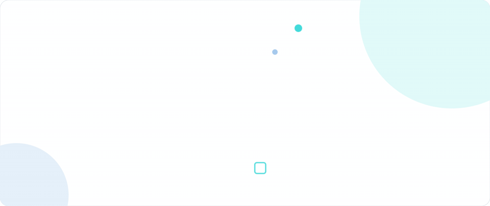<br><br>
  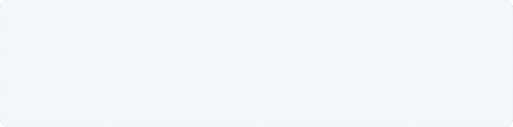<br><br>
  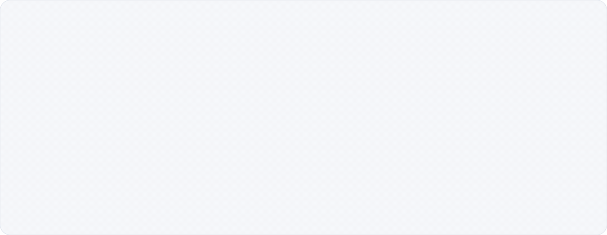<br><br>
  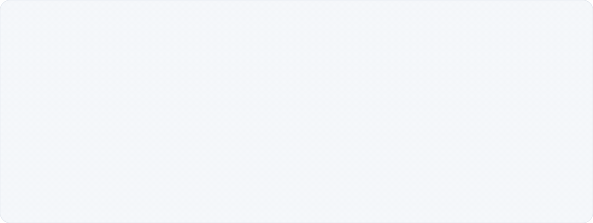<br><br>
  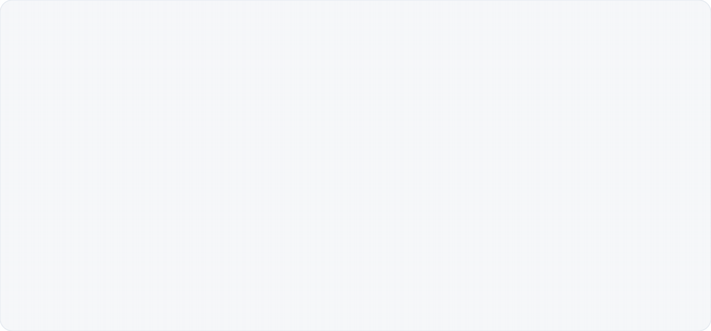<br><br>
  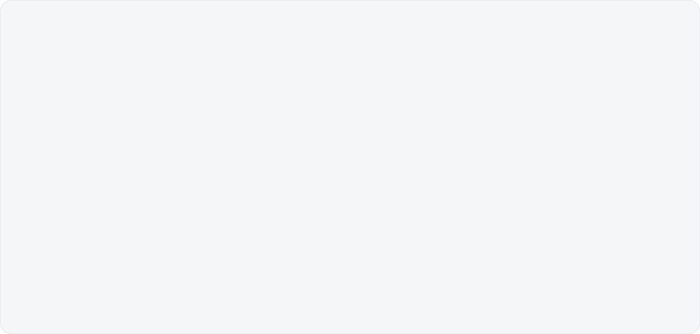<br><br>
  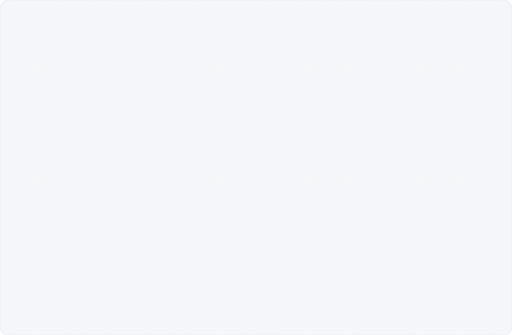<br><br>
  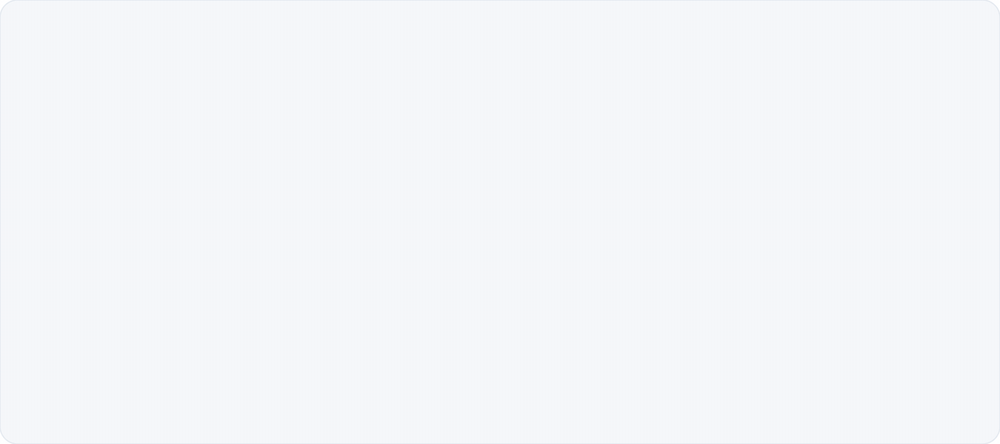
</p>

</details>

---

<div align="center">

**IntoAEC · Power Up Your Business**<br>
MAEC Report · Jul – Oct 2026

</div>
